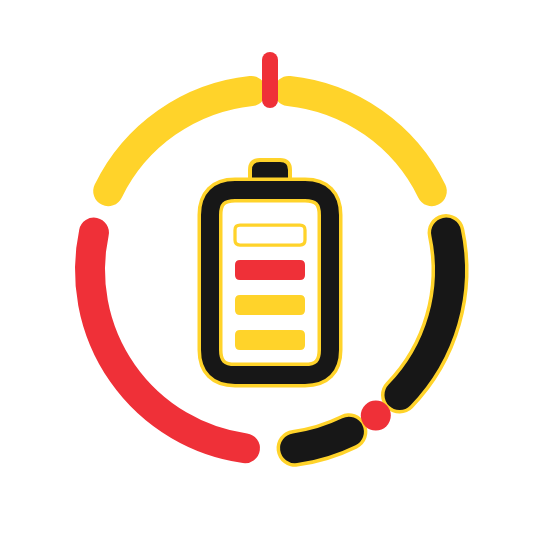
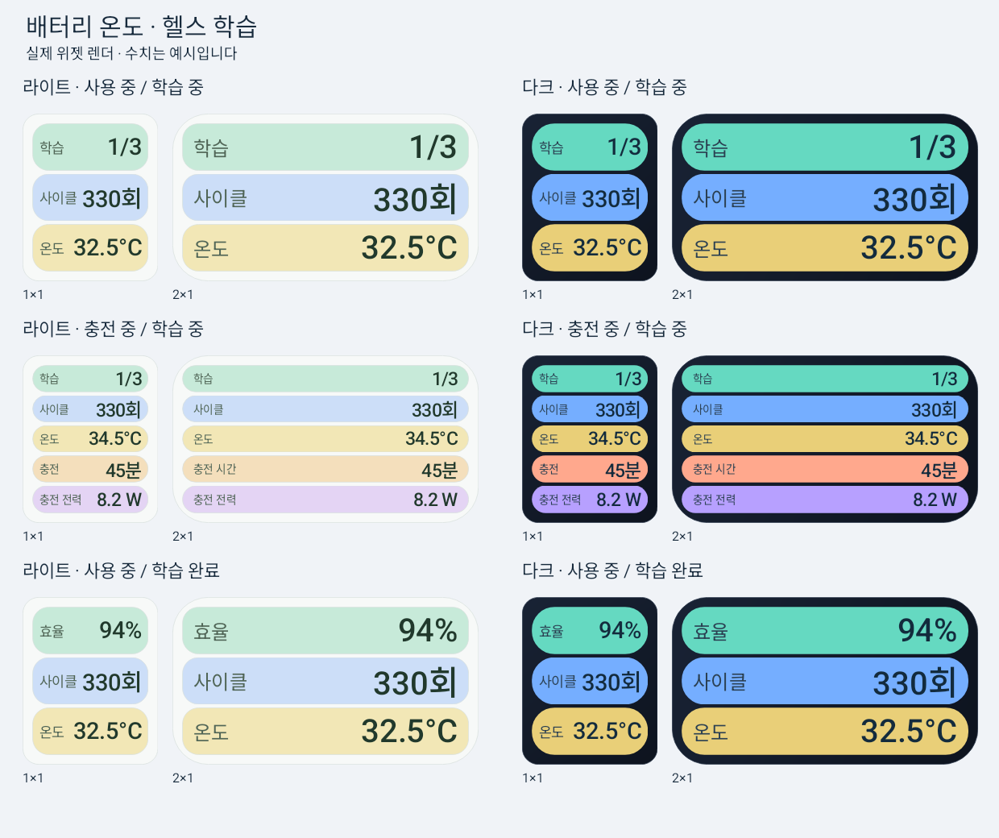

# 배터리리스크제로

**배터리 상태와 교체 시점을 살피는 위젯**

### [⬇ 설치 파일 바로 받기 — battery-risk-zero-1.0.1.apk](https://github.com/ZERO-hms/battery-risk-zero/releases/download/v1.0.1/battery-risk-zero-1.0.1.apk)

GitHub 계정 없이 받을 수 있습니다. 현재 버전: **1.0.1 정식 버전 · 빌드 25**

[설치·보안 안내](INSTALLATION.md) · [버전별 다운로드](https://github.com/ZERO-hms/battery-risk-zero/releases) · [변경사항](CHANGELOG.md) · [검증 범위](VALIDATION.md)

## 왜 만들었나요?

배터리 상태를 보려고 여러 메뉴를 찾는 번거로움을 줄이고, 평소 배터리의 노후화와 충전 상태를 살펴 서비스센터에 점검을 문의할 시점을 챙기기 위해 만들었습니다.

휴대전화에서 얻을 수 있는 용량·전하량·사이클 데이터를 활용합니다. **삼성 멤버스나 삼성의 공식 진단값을 가져오는 앱이 아닙니다.** 효율·예상 시간·전력은 기기와 데이터에 따른 추정값이며 무상교체 여부를 판정하지 않습니다.

## 주요 기능

| 기능 | 표시와 동작 |
| --- | --- |
| 배터리 헬스 · 효율 | 완충 용량 ÷ 기준 용량 × 100. 현재 잔량이 아닌 용량 유지율을 뜻합니다. 데이터가 부족하면 숫자를 만들지 않고 학습 중 또는 —로 표시합니다. |
| 배터리 온도 | Android가 제공하는 배터리 센서값을 °C로 표시합니다. 값이 없으면 —로 표시합니다. |
| 헬스 학습 진행 | 효율 계산 전 위젯의 효율 칸에 학습 0/3~2/3을 표시합니다. 기록 편차가 크면 재학습으로 표시합니다. 앱에서는 현재 구간의 진행률과 대기 이유를 확인합니다. |
| 사이클 | 기기가 제공하는 사용한 사이클 횟수입니다. 남은 횟수가 아니며 기기에서 제공하지 않으면 —로 표시합니다. |
| 충전 시간 | 전원을 연결했을 때만 표시합니다. 충전 완료 예상치가 없으면 확인 중, 멈추면 충전 대기 등 기기 상태를 표시합니다. |
| 충전 전력 W | 위젯에서는 실제 충전 중일 때만 표시합니다. 순간 전류 × 배터리 전압으로 구한 배터리 순전력 추정입니다. 충전기 표기 출력이나 USB 입력 전력이 아닙니다. |
| 두 가지 위젯 | 1×1 · 2×1. 전원 분리 시 효율(또는 학습)·사이클·온도, 충전 중에는 충전 시간·W도 표시합니다. 충전 대기·완료에서는 W 칸을 숨깁니다. |
| 꾸미기와 미리보기 | 모노·소프트, 자동·라이트·다크 색상, 바깥 배경 투명도 0–100%, 글자 크기 70–150%. 예시 데이터로 크기별 모습을 미리 봅니다. |
| 자동 갱신 | 기본 1분, 충전 중 화면이 켜져 있으면 약 5초. 실행 상태 알림을 표시하며 절전 중에는 지연될 수 있습니다. |
| 보증 점검 | 구입·수령일 기준 예상 또는 확인한 보증 종료일 직접 입력. 30일 전·7일 전·종료일 알림을 선택할 수 있습니다. |
| 기록과 참고선 | 일별 효율·사이클 기록, 기본 80%의 점검 참고선. 80%는 무상교체 확정 기준이 아닙니다. |
| 업데이트 | 지금 확인, 6시간 간격 자동 확인·알림, 알림 테스트, 변경사항. 새 정식 버전만 자동 안내하며 테스트 버전은 이 페이지에서 직접 받습니다. |

투명도는 **색상 칸 밖의 바탕에만** 적용됩니다. 색상 칸과 글자는 유지됩니다. 글자를 키워도 공간이 부족하면 잘리지 않는 크기에서 멈춥니다. 위젯을 누르면 앱을 열어 갱신합니다.

## 위젯 미리보기

수치는 예시입니다. 왼쪽은 라이트, 오른쪽은 다크이며 각 상태에서 1×1·2×1을 비교합니다.

## 설치 방법

1. 위 **APK 바로 받기** 링크를 누릅니다. 파일명은 `battery-risk-zero-1.0.1.apk`입니다.
2. 다운로드한 APK를 브라우저나 파일 앱에서 엽니다.
3. 설치 허용이 필요하면 **APK를 여는 브라우저·파일 앱**에만 ‘이 출처 허용’을 적용합니다. 설치 후에는 다시 끕니다.
4. 설치가 차단되면 [설치·보안 안내](INSTALLATION.md)를 확인하세요. 갤럭시 보안 위험 자동 차단, Play 프로텍트 검사와 유해 앱 경고, 관리 기기 제한을 구분해 안내합니다.
5. 앱을 한 번 열고 **홈 화면에 위젯 추가**를 누르거나 홈 화면을 길게 눌러 위젯 목록에서 선택합니다.
6. 톱니바퀴 → 설정에서 위젯 모양·보증 종료일·알림을 선택합니다.

기존 앱을 삭제하지 않고 APK를 열어 업데이트하세요. 기존 동일 서명 앱의 설정·학습 기록을 유지합니다. 미리보기 1.0.1 사용자는 APK를 직접 받아 설치하세요. 3×2 위젯은 제거되었으므로 홈 화면에 남은 빈 위젯은 지우고 1×1 또는 2×1로 다시 추가하세요.

GitHub의 **Source code ZIP/TAR은 공개 안내 자료**입니다. 앱 소스나 설치 파일이 아니므로 설치할 때는 반드시 `.apk`를 받으세요.

## 지원 환경과 제한

- Android 15(API 35) 이상, One UI 7.0 이상 갤럭시 대상입니다.
- 폴드7 바깥 화면 5×6 격자에 대응하도록 위젯 최소 크기를 조정했습니다. **현재 APK의 폴드7 / One UI 9.0 실기기 재검증은 남아 있습니다.**
- 기종·펌웨어가 제공하는 데이터에 따라 효율·사이클·시간·W 일부를 얻지 못할 수 있습니다.
- **고속·초고속 충전 모드는 자동 판정하지 않습니다.** W만 보고 일반·고속·초고속을 판정하지 않습니다.
- 배터리 보호 충전 한도를 직접 확인하지 못하며 100%까지의 충전을 보장하지 않습니다.
- 깊은 절전, 강제 종료, 제조사 정책에서는 갱신·알림이 늦어지거나 멈출 수 있습니다. 강제 종료했다면 앱을 다시 여세요.
- 자동 갱신을 끄면 약 30분 기본 갱신과 앱의 수동 새로고침을 사용할 수 있습니다.
- 보증 종료일은 사용자가 확인한 계약·구입 상황에 맞게 입력합니다. 무상교체는 서비스센터 진단과 보증·가입 조건으로 결정됩니다.

## 효율은 어떻게 계산하나요?

기기에서 유효한 완충 용량과 설계 용량을 함께 제공하면 그 비율을 사용합니다. 읽을 수 없으면 방전 중 전하량 감소와 잔량 감소 비율로 완충 용량을 추정합니다. 제조사 전력 계산용 기준 용량 또는 사용자가 확인하여 입력한 기준 용량과 비교합니다.

예를 들어 완충 용량 4,000mAh와 기준 용량 5,000mAh라면 효율은 80%입니다. 기준 용량 자체도 기기별 출처와 보정에 영향을 받습니다.

학습은 전원 분리·잔량 20–90%·온도 10–40°C 구간에서 진행합니다. 최소 1시간·30%p 감소한 방전 구간을 3회 이상 모으고 편차를 확인합니다. 평소처럼 사용하면 기록하며, 데이터나 관측이 부족하면 학습이 진행되지 않을 수 있습니다. 이 조건은 앱 자체의 수집 기준이며 정확도 인증은 아닙니다.

계산식과 자세한 조건은 **설정 → 도움말 → 계산 방법 · 데이터 안내**에 있습니다. 기준 용량을 변경하면 기존 용량 학습·효율 기록이 초기화됩니다.

## 권한과 개인정보

- **알림:** 자동 갱신 실행 상태, 보증 점검, 업데이트 안내에 사용합니다. 알림을 거부해도 조회와 위젯은 사용할 수 있으며 실행 서비스는 시스템의 실행 앱 목록에서 확인할 수 있습니다.
- **포그라운드 서비스:** 화면 밖에서도 위젯 데이터를 주기적으로 확인합니다. 설정이나 알림에서 중단할 수 있습니다.
- **부팅 완료:** 재부팅 후 갱신·업데이트 확인을 다시 예약합니다.
- **인터넷·네트워크 상태:** 연결이 있을 때 공개 GitHub 릴리스 정보를 확인하고 예약하는 데 사용합니다. IP 등 일반 접속 정보는 GitHub에 전달될 수 있습니다. 배터리 측정 기록은 전송하지 않습니다.
- 접근성·사용정보 접근·위치·정확한 알람·전체 파일 접근 권한을 요구하지 않습니다. ‘제한된 설정 허용’도 필요하지 않습니다.
- 기록은 기기 내부에만 보관하며 서버 백업·기기 간 이전을 하지 않습니다. 용량 학습은 최대 30일·7개 표본, 일별 효율 기록은 최대 90개입니다.
- **측정 기록 초기화**에서 지울 수 있습니다. 기준 용량·보증 설정은 유지됩니다.
- 호환성 정보 복사에는 모델·OS·측정 출처 등이 포함되며 IMEI·일련번호·계정을 넣지 않습니다. 공유 전 내용을 확인하세요.

## 현재 버전

**1.0.1 · 정식 배포**

배터리 온도와 헬스 학습 진행률·대기 이유를 추가했습니다. 남은 사용시간과 3×2 위젯은 제거했고, 위젯의 충전 전력은 실제 충전 중에만 표시합니다. 충전 시간은 유지합니다. [변경사항](CHANGELOG.md)과 [검증 범위](VALIDATION.md)를 확인하세요.

문제는 [Issues](https://github.com/ZERO-hms/battery-risk-zero/issues)에 모델, Android/One UI 버전, 앱 버전과 재현 순서를 남겨 주세요. 개인 식별정보는 포함하지 마세요.

이 저장소에는 APK 배포 안내·승인된 이미지·검증 정보만 공개합니다. 앱 구현 소스와 서명 키는 포함하지 않습니다.
